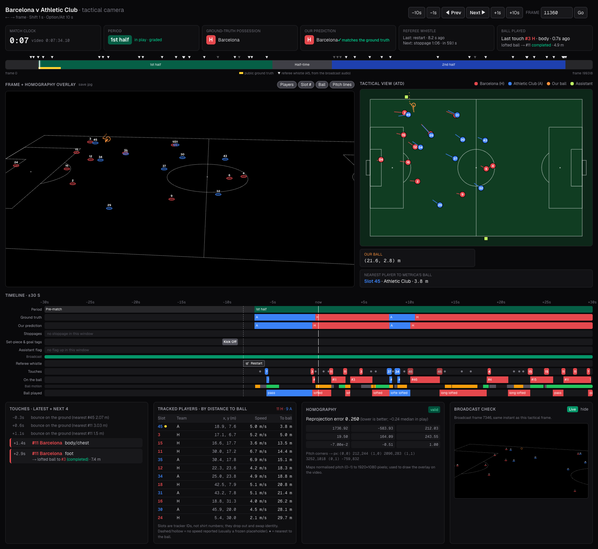
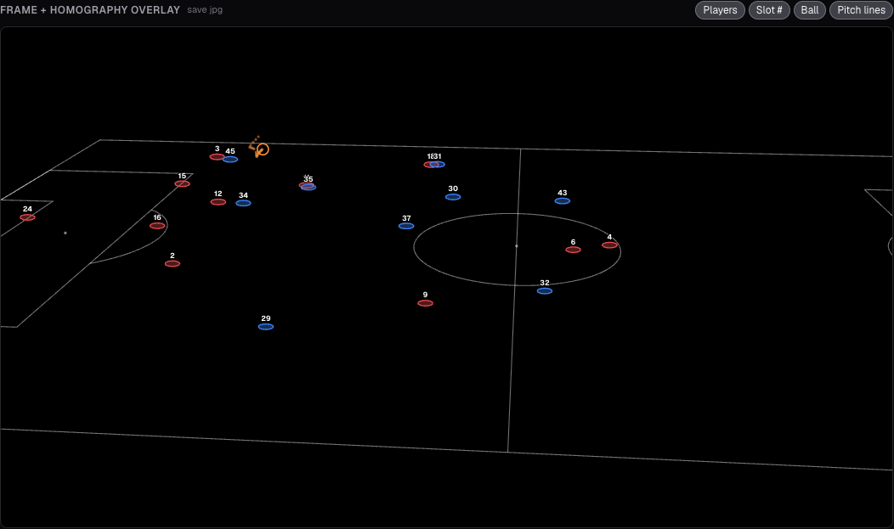
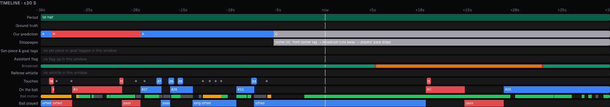

# Who has the ball: our own ball, players and officials, then touches

**More than a Hack 2027, Phase 1: technical document.**

We answer the question from the picture rather than from the provided ball. We find the ball, the players and the
assistant referees in the tactical video ourselves, with detectors that teach themselves from the match, **without a
single hand label** (section 1.2 walks through a training run). A *touch* is a break in the ball's motion at a player's
body. Possession is decided from the sequence of touches, and dead balls from set-piece tags, the referee's
whistle, the ball leaving the pitch and the players' pace.

On the public five minutes:

| | macroF1 | spellF1 | possessions (truth: 17) |
|---|---|---|---|
| **Our possession rules** (submitted) | **0.972** | **0.827** | 13 |
| `baseline_smooth125` (the best published baseline) | 0.581 | 0.424 | 16 |

The sections follow SUBMISSION.md: the approach, the assets we used and dropped, the possession rules, limitations,
and reproduction. Section 6 shows the viewer we built to check all of it, frame by frame. RULES.md's two requirements on the task, labels made by an algorithm and no private ground truth,
are covered under the approach (sections 1.2 and 1.5), and section 1.6 sets out the roads we did not take.

---

## 1. The approach

**What we built, and why.** The provided tracking is automatic and uncorrected. Metrica's ball is full of holes and
lags behind the play, worst of all in duels, which is exactly where possession changes: it is missing on 41% of
graded frames, and players are lost behind each other in those same duels. That is why we use models: our own
detectors find the ball, the players and the officials in the video (sections 1.1 to 1.3), rather than smoothing what Metrica
gives.

Possession itself we decide with **rules**, because football is already a very organised game. The Laws of the Game
say when the ball is out of play, how play restarts and who restarts it, and possession passes from one team to the
other only through touches on the ball. A model does not need to learn some complex function to reproduce that. One
that tried would also be uncertain from frame to frame, so its prediction could swing between neighbouring frames
where nothing on the pitch has changed. A rule changes possession only at a touch or a stoppage, so it stays put in
between, and each rule can be checked against the Laws and CHALLENGE.md clause by clause. Section 1.6 sets out the other
roads we considered.

### 1.1 What we rebuilt

We find the ball, the players and their kits, the assistant referees and their flags in the tactical video ourselves
(sections 1.2 and 1.3), place the broadcast on the tactical clock to hear the referee's whistle (section 1.4) and to see the ball from a
second camera, and snap the homography to the painted lines. Section 5 lists every step.

### 1.2 Detectors that teach themselves: no hand labels

**No hand labels were used anywhere in the pipeline: none to train a model, none to validate one.** Nobody marked a
ball, a player, a kit, a flag or a touch on a single frame. The submitted file is written by `ballcv/run_match.py` from
the models' outputs, and nothing in it was corrected by a person. The only labels we ever looked at are the
organisers' public five minutes, as a final check (section 1.5).

Each detector **teaches itself** the same way:

1. **Round 0, the seed.** A label is made only where two independent sources agree, for example the tracking and
   simple colour rules on the picture. Rather fewer labels than wrong ones.
2. **Rounds 1 to K.** Model *k* is trained from scratch on every label so far. It then labels fresh frames where it
   is at least `conf_min(r)` sure. That bar starts at 0.8 and drops 0.015 a round, and it is the same schedule for
   every detector: there is no ground truth to tune it on.
3. **Every round is checked without labels**, on held-out seed frames. For players, for example: are the seed
   players found, how many detections have no tracked body near them, and does a team ever come out with more than
   eleven?

| Detector | Seed: the two sources that agree | Label-free check |
|---|---|---|
| Ball (`selftrain.py`, 18 rounds) | Metrica's ball **and** a lone ball-sized, round, whitish blob within a few metres of it | the seed's held-out balls |
| Kits (`kit_team.py`) | Metrica's team on a mature, unoccluded track **and** an uncrowded crop | validation accuracy per kit |
| Players (`player_det.py`) | Metrica's player alone in the picture **and** the kit model reading his slot's kit | found 98.0%, 0.48 extra detections a frame, a team over eleven on 4.5% of frames |
| Assistants (`assistant_self.py`) | lime shirt and socks on the touchline **and** level with the offside line from the tracking | the seed's held-out assistants; agreement with the offside line |
| Flags (`flag_self.py`) | one flag-sized orange-red patch in the assistant's hand, moving with him over neighbouring frames | found, steadiness, and raised flags while play is on |

**A training run, step by step: the ball detector** (`python ballcv/selftrain.py run`). The numbers are from the
run that made the committed `ballcv/models/ball.pt` (`self/rounds.csv` and each round's `log.csv`).

1. **Round 0, the seed.** 15,000 frames are tried, spread over both halves. None is from the public five minutes,
   and none is a still frame (players standing about, as in a stoppage). A frame is labelled only where Metrica's
   ball and the picture agree: the only ball-sized, round, whitish blob within 3 m of Metrica's ball, no more than
   1.5 m from it, with nothing else bright within a metre. Metrica alone drifts onto players, and the picture alone
   finds socks and kit, but both are rarely wrong at the same spot. The seed is strict, so it fires on only
   **565 frames**. Each of them also gives "not a ball" examples: every other blob in the frame at least three ball
   widths away.
2. **Round 1.** A network is trained from scratch on those 565 frames, with every fifth one held out. Those held-out
   frames are seed labels too: the validation asks whether the network finds the ball where Metrica and the picture
   agreed, on frames it never trained on. It does so in 94.3% of them after the first epoch, and in 97.8% at the
   epoch with the lowest validation loss, which is the one kept. It puts its top peak on a "not a ball" crop under
   0.7% of the time. Model 1 then looks at 3,000 fresh frames and keeps a label wherever it is at least 80% sure:
   **234 new balls**.
3. **Rounds 2 to 17.** Each round trains a new network from scratch on every label so far. Before it starts, the
   previous model is scored on the new validation set, as the baseline to beat. The bar for a new label comes down
   a little each round as the models improve. Labels are kept one per 2 s moment, so the model does not learn twenty
   copies of one picture, and every fourth round the same moments are opened again for the better model. That is why
   the new labels jump at rounds 4, 8, 12 and 16 (801, 1,071, 1,214 and 1,312).
4. **The model in use.** Model 17 was trained on **7,225 labelled frames**, 13 times what the seed gave. Its held-out
   frames are every fifth of all those labels, most of them made by models 1 to 16. It finds the ball on 99.7% of
   them, with 0.4% false alarms, and its validation loss is 0.075 against model 1's 0.221. It is copied to
   `ballcv/models/ball.pt`.

These scores measure agreement with labels the pipeline made itself, never with the truth. They show that each model
learned its labels and generalised to frames it did not see. They cannot show that those labels were right. That is
what the seed's caution is for (two independent sources, both wrong at the same spot, is rare). It is also what the
later checks look for. Without any labels, we check that the ball's path through the detections is physical
(section 1.3). Last of all, the organisers' public five minutes check possession as a whole, and no detector ever
trained or validated on those frames.

The other detectors run the same loop with their own seeds (the table above), so every label any of them learned
from was made by an algorithm: first by two sources agreeing, then by the models themselves.

### 1.3 The ball, the touches and the players

**The ball and the touches.** The ball detector finds up to eight candidates a frame. Dynamic programming picks the
smoothest physical path through them, in camera-stabilised pixels: the tactical camera only pans, tilts and zooms
about a fixed centre, so any two frames are related by an exact homography, whatever the ball's height. A touch is a
break in that path, found by comparing fits of the motion just before and just after each frame (below).

**The players.** `player_track.py` keeps Metrica's 46 slots as identities. It moves each slot to the detector's
player of the same kit (one-to-one, nearest overall). Where nobody matches, a slot keeps Metrica's position, or
follows the player hiding it, or coasts for a moment. Every path then goes through one Kalman smoother whose noise is
measured on the match: about 0.02 m for the picture, about 0.09 m for Metrica, and accelerations of about 1 m/s².
This puts back the players Metrica loses in duels. In the public window, a Barcelona player hidden behind an Athletic
one at the far touchline had been tracked as Athletic, and every touch there went to the wrong team.

Each piece is judged against physics:

- **Touch or bounce** (`ownball.py events`). At each break in the ball's motion:
  - **A touch**, if the ball is at a player's body column: within 0.7 m always; otherwise within a reach of
    0.5 m + 0.05 m per m/s of velocity change (at most 1.5 m), with the change pushing the ball away from him.
  - **A bounce**, if the velocity change points straight up the image's local vertical while the ball is falling.
    The vertical comes from the camera at every point of the picture, so the direction of gravity is known there.
  - **Not a touch**, if the ball is high and passing over a player: Metrica's ball goes straight through the moment.
  - **Reasonable constants, not a model.** Nothing in our pipeline sees a foot meet the ball, so a touch is inferred
    from the ball's motion and a player's reach. The numbers that draw that line (a 5 m/s change, a 0.7 m contact,
    a reach of at most 1.5 m) are chosen from the body and the physics of a kicked ball, and rounded. They are not
    fitted to the match, and a better touch decision needs a model that sees the contact (section 4).
  - **Settled by a second camera** (`broadcast_check.py`), when a break looks like a bounce but a player's body is
    over the ball in the picture. Taking a dropping ball on the chest changes its motion the same way a bounce does,
    and the tactical camera looks down, so a ball bouncing several metres behind a player sits on his body in the
    picture. The broadcast camera stands about 14 m away and is zoomed about three times further in; there the two
    are tens of pixels apart. We run our own ball detector on the live broadcast picture, shrunk by the two cameras'
    focal lengths to the scale it learned on, and intersect its ray with our tactical ball's ray. Two lines in space
    do not meet by chance, so a frame counts only where they meet, within the same 0.25 m that `ball3d.py` asks of a
    flight. The ball's place in 3D then decides: within the player's reach it is his touch, otherwise not. Where
    the broadcast cannot see the ball, the picture's closeness stands. Of 191 such breaks over the match, the broadcast
    sees the ball at 82, and puts it beyond the player's reach at 41.
- **The ball in the air** (`ball3d.py`). Between two breaks the ball either rolls or flies on a gravity arc. Fitting
  the arc to the rays through the ball's pixel gives its height, so a ball in the air past a line is not called out.

### 1.4 The referee's whistle

**Learned from the kick-offs** (`alignment/detect_whistles.py`). Nothing in the detector says what the referee's
whistle sounds like: no band, no pitch, no number of tones. It is learned from the match's own kick-offs, which the
Laws of the Game make him whistle and the smart tags mark. Across the whole audible band, the detector looks for
tonal sound: a line narrow in frequency, louder than the same frequency a moment before, and held. Then it asks which
frequencies stand out more in the 25 s after a kick-off tag than in any other 25 s of the match. Significance is
judged against random sets of six windows, so that neighbouring frequencies are not counted as separate tests. His
whistle at each kick-off is where those frequencies peak; his tones are the lines it holds at most kick-offs. On
BAR-ATH that is two tones, 3836 and 4266 Hz, found at five of the six kick-offs; the sixth tag has only a faint pip.
Commentary, crowd and the mix's constant hum all fail the test. A whistle is then his tones sounding together; a run
too short to be a whistle is kept as a pip, which only times a stoppage that other evidence shows.

An earlier version found his tones without the tags, as the two pitches the match's whistle sounds hold most
often. The two agree on 39 of that version's 45 whistles, score and all. But a constant hum in the mix pulled one of
its tones 130 Hz low, so five other sounds passed as his. Two of them made false stoppages: a keeper holding the
ball while players walked back, and advantage played on at the edge of the box. In the broadcast, play is live in
both. Learning the tones from the kick-offs removes both, about 36 s of play, and changes nothing else. Its two hits
in the public window are stoppages, 0.3 s and 0.6 s before the labelled dead ball.

### 1.5 The public five minutes: a check, not a target

Only the public five minutes exist for us, and **nothing is fitted or selected on them**. Every frame in that window
is kept out of every detector's training, and no threshold or weight was tuned on it: the constants are physical, or
measured on the match itself without labels (the referee's whistle, for one, is learned from its tagged kick-offs).
We use the window as a correctness check: when it scored worse, we looked for the error in the mechanism, not for a
better constant.

### 1.6 Why this rather than something else

| the road not taken | why not | what we do instead |
|---|---|---|
| **Smooth the provided ball and tracking** | Metrica's ball is full of holes and lags, worst of all in duels, exactly where possession changes: it is missing on 41% of graded frames, and players vanish behind each other in those duels. The best published baseline, which does this, scores 0.581 / 0.424 | Rebuild the ball, the players, the camera and the officials from the video (sections 1.1 to 1.3) |
| **Learn possession from tracking features** | Football is organised: the Laws fix the restarts, and possession moves only by touches, so there is no complex function to learn. A learned model is also uncertain frame to frame, and its prediction can swing between neighbouring frames. | Rules, each checked against the Laws of the Game and CHALLENGE.md (section 3) |
| **Pretrained or foundation models** | We tried an open-vocabulary detector (section 2). It did not beat a simpler method trained here, and a model trained here can be retrained and checked end to end | Small networks, defined in `ballcv/` and trained from scratch on the match |
| **The ball's height from one camera** | From a camera high above the pitch, a ball on a player's chest and one bouncing metres behind him fall on the same pixel | The broadcast as a second camera: two rays meeting place the ball in 3D (section 1.3) |
| **One global optimisation for every player's track** | A min-cost-flow tracker fixed the duel it was built for, but broke tracks into pieces elsewhere | Keep Metrica's 46 slots as identities, move each to our detections, and smooth every path once (section 1.3) |
| **Time stoppages from the tags** | The tags say that play stopped, but are often seconds off | Evidence chains: one link says it happened, the next says when (section 3) |
| **Thresholds tuned on the public window** | Five minutes would be all they fit | Constants from the Laws, physics and the body, or measured on the match without labels (section 1.5) |

## 2. The assets we used, and those we dropped

Everything in the pipeline is in this repository. There are no pre-trained models, commercial APIs or LLMs anywhere
in it. Every network is small, defined in `ballcv/`, and trained here from scratch.

| Asset | How we use it |
|---|---|
| Tactical video | Everything we detect: the ball, the players and their kits, the assistant referees and their flags |
| Tactical tracking (ATD) | Players: a seed for our detectors, and identities for our tracker. The ATD ball seeds the ball detector and flags balls flying over a player. It never places a touch |
| Tactical homography | Refined against the painted lines and mowing stripes (`refine_h.py`), then used everywhere |
| Smart Tagging | The set-piece tags: which restart a stoppage waits for, and who takes it |
| Broadcast video | Put on the tactical clock by aligning the two feeds. Its **audio** gives the referee's whistle; its **picture**, a second view of the ball, settles touches the tactical camera cannot see in depth (section 1.3). Live frames only |
| A product photo of the match ball, the Puma Orbita ([public URL](https://www.prodirectsport.us/products/puma-orbita-laliga-1-24-25-fifa-quality-pro-puma-white-multicolor-puma-white-multicolor-1008765)) | One constant: the ball's mean colour, so the ball detector's seed looks for whitish blobs. `python ballcv/selftrain.py orbita` measures it again from the photo, which is not committed |

**Tried and dropped.**

| what we tried | why we dropped it | what replaced it |
|---|---|---|
| Metrica's broadcast ball, fused with the tactical one | It lags and is smoothed, so it cannot be triangulated with our ball | Our own ball detector, run on the broadcast picture (section 1.3) |
| A classical CV ball finder (colour, size, roundness) | On its own it finds socks and kit as readily as the ball | Kept only as half of the ball detector's seed, beside Metrica's ball (section 1.2) |
| A supervised assistant-referee classifier | Its labels came from a colour rule and a language model's review | `assistant_self.py`, seeded by the kit colour and the offside line (section 1.2) |
| OWLv2, an open-vocabulary detector, on the assistants and their flags | It picked the same assistant as our colour rule in 93% of frames on the far line and 83% on the near line, but did no better, and it is a pretrained model we cannot retrain on the match | `assistant_self.py` and `flag_self.py` (section 1.2) |
| A self-trained touch detector | We inspected its output: it called a touch wherever the ball was near a player. Its seed had taught it that "near the ball" means "touched it" | The physical touch rule (section 1.3) |
| A min-cost-flow player tracker | It fixed one hidden duel but broke tracks into pieces elsewhere | `player_track.py`: Metrica's slots on our detections, one smoother (section 1.3) |
| The whistle's tones as the two pitches the match's whistles hold most often | A hum in the mix pulled one tone 130 Hz low: five false whistles, two false stoppages | Tones learned from the kick-off tags (section 1.4) |
| Touches inside the ball's gaps: fits across them, heads found in the picture | Fits across gaps made false breaks, and heads in the picture brought back the depth illusion | Nothing yet: section 4 |

## 3. The possession rules

CHALLENGE.md asks for a change of possession only on *controlled* possession, and for `D` whenever the ball is not in
play. Here is how we drew those lines.

We think of every cue as **evidence**, and the evidence comes in two kinds. Some tells us **that** something
happened: play stopped, or the ball changed hands. Some tells us **when** it happened, to the frame. Few cues do both
well. A set-piece tag is certain that play stopped, but it is dated loosely, often seconds off. The players slowing
down can be timed to the frame, but on its own it proves nothing, since a player can stop running for any reason. So
we **chain** evidence: the first link says the event happened, and the later links narrow down when. The order of
play constrains the chain. A goal is scored only in play, a restart has to put the ball back in play, and a ball
cannot be dead and live again at once.

**Dead ball** (`stoppages.py`). The evidence:

| evidence | says **that** play stopped | says **when** |
|---|---|---|
| Set-piece and goal tags (Metrica) | yes, and which restart, and who takes it | loosely: seconds off |
| The referee's stoppage whistle | yes | to a fraction of a second |
| Players setting up a restart (one at a corner arc, or off the pitch over a touchline) | a sign, when the players then pause: in play a player can run off the pitch or shield the ball at the corner flag | no |
| Our ball crossing a line, and staying off the pitch | yes, if it is not in the air (`ball3d.py`) | to the frame |
| Our ball seen in the goal, for a tagged goal | with the tag | to the frame |
| The referee's pip (a whistle too short to stand alone) | no | yes, once something else says play stopped |
| The broadcast cutting away to a close-up or replays | weakly | roughly: play had stopped by then |
| Nobody running for over 20 s (the three fastest players under a jog) | weakly: only with replays or a restart whistle | no |
| The players easing off (the biggest drop in their pace) | no | yes, inside a window the other evidence gives |
| The assistant's flag | no (see below) | only for an out something else found |

So a tagged corner whose ball we lost goes **corner tag → nobody running → players stopped**. The tag says a corner
is coming, the stretch with nobody running says play had stopped before it, and the players' pace dropping picks the
frame. A goal goes **whistle → ball in the goal**: the whistle says play stopped, and our ball crossing the goal
line, a moment before it, dates the stop. Over the match, our 89 stoppages are timed by the ball leaving the pitch
(44), a whistle (20), the players' pace (13), the flag (3), the ball in the goal (3), the broadcast (4), and the
referee's pip and the half's first frame (one each). The viewer shows each stoppage's chain, in order.

**When play restarted** follows the same idea. Where the ball itself can be trusted, it decides: the placed ball
struck, for a goal kick or a corner, or the kick after the referee's restart whistle, for a free kick. That covers 46
of the 89 stoppages. Everywhere else, the players' pace rising out of its lull times the restart. A restart has to
lead to play: if play stops again within a few seconds, or before anyone ran, it was the same stoppage. **Who has
the ball after** is the team named on the tag, or otherwise the team of the player at the ball when it restarts.

**The flag is the weakest evidence we have.** The flag detector (`flag_self.py`) taught itself, like the others, but
it has much less to learn from. The assistants raise their flags only a handful of times in a match, and we have no
hand labels to measure the detector against. It reports 92 raises over the match. On the near touchline 14% of them
follow the ball going out, against 5% by chance, and on the far touchline none do. So a raise never makes a stoppage
by itself. It only times an out that a tag or a set-up already says happened, and it does so for 3 of the 89.

**Live play: the rules, which we submit** (`ownball.control_roles`, then `possession/predict.py`). Here too the
evidence chains. A touch by the team not in possession says the ball *may* have changed hands. That team's next
play on the ball says it did. The start of its stretch on the ball says when. A touch takes the ball only if it is
controlled:

| case | change of possession? |
|---|---|
| the ball reached him **loose** (a bounce or a deflection since the last touch) | yes: nobody had it. But not in a **duel**, with a player of the team in possession within reach too: who touched it is in doubt, and the other team's touch is as likely a block |
| his team's **next play on the ball is theirs again** (its next touch, or a stretch on the ball, whichever comes first), or nothing follows | yes: an interception or tackle that kept it |
| a **goalkeeper's claim** | yes, at once. A claim we cannot see (the ball vanishes, and is next seen in his hands) is dated when the ball, at the speed it was last seen at, reaches him |
| a lone touch **between two of the other team's** | no: a block, a poke or a deflection of a pass |
| a head-height "touch" of a ball **flying over** him | no: not a touch at all |

So a contested or loose ball stays with the last team that had it until someone controls it, as CHALLENGE.md asks,
and an aerial duel won without control by that team does not change possession.

A player can have the ball for seconds with touches too gentle to break its motion, or take it while we cannot see
it. So we also ask who the ball is *with*. A player is *on the ball* from a frame it is at his feet (within
`CONTACT_M`, at foot height) while he stays the player nearest to it on the ground, for at least `PLACED_S`. We compare
on the ground because the picture puts a ball running on behind a player on his body. A ball he controls moves with
him; one he blocks, or that runs past him, leaves him, and someone else is soon nearer. Being on the ball changes
nothing by itself, since a ball rolling past a standing player looks the same. But a change of
possession is dated from the start of the taking team's stretches on the ball just before its touch: not before the
previous touch, the start of the half, or a dead ball. A player's touches and stretches on the ball make up his
*spell*, and a ball played goes from one player's spell to the next player's.

## 4. Limitations and next steps

**The ball's height: depth is our weakest point.** The tactical camera looks down from high in the stand, so it
cannot tell how high the ball is. A long ball passing over a player falls on his feet in the picture, and can be
credited as a touch on the ground. We fit gravity arcs between breaks (`ball3d.py`), and the broadcast settles a
break where it is live and sees the ball (section 1.3), but neither always applies: an arc needs enough of the flight seen,
and the broadcast is often on a close-up or a replay. Some long balls are still credited as touches by the player
they fly over.

**Touches are inferred, not seen.** A touch is a break in the ball's motion within a player's reach (section 1.3). We
had to settle for reasonable constants there, because we have no computer-vision module that sees the contact itself.
Where it fails:

- **Duels.** When two players meet with the ball between them, the tactical camera often loses it. In the public
  window almost all of our spellF1 loss is two short home spells won in duels. One touch is hidden from both cameras.
  The other is a header both cameras see, but we model a player as an upright column over his feet, and this player
  is leaning, so his head is not where we put it.
- **The wrong player in reach.** At a crowded break, the nearest body is not always the one that played the ball.
  The fixed reach cannot tell a toe-poke at full stretch from a ball running past an outstretched leg.
- **Gentle touches.** A soft touch changes the ball's motion too little to break it. A player keeping the ball at his
  feet covers most of these, but not a first touch that only cushions it.

**Next: a touch model.** A detector, trained like our others from the match itself, that looks at the player and
the ball at each break and says whether he played it. It would replace the reach constants and settle the crowded
cases. Our first attempt, a self-trained touch detector (section 2), called a touch wherever the ball was near a
player when we inspected it: its seed had taught it that "near the ball" means "touched it". A new one needs evidence the reach rule does not use, such as the foot and the ball in the
broadcast's closer picture, or a pose model's limbs in place of the upright column.

**The flag is weak evidence.** The assistant's flag detector sees 92 raises in the match and 14% of the near-side
raises follow an out (section 3), so it only ever times an out that something else found. It is unclear how to
improve it from this match alone: a match has only a handful of real raises to learn from, and we have no labels to
check against. Two ways forward:

- **More video of assistants.** Footage from many matches together, which has enough flag raises to learn from.
- **A pretrained pose model on the assistant.** We already find the assistant referees very reliably
  (`assistant_self.py`). A pose model run on that crop would read a raised arm directly, instead of learning the flag
  from a few examples.

**Other known gaps.**

- **One match.** Every constant comes from the Laws of the Game, physics, the human body or the match metadata, but
  the pipeline has only ever run on BAR-ATH.
- **Sequence checks.** Our sequence check still flags 8 places in the match: 4 where the tag names a different restart
  from ours, and 4 stretches of live play where nobody runs.

## 5. Reproduction

**One command.** The trained models are committed in `ballcv/models/` (the ball, kit, player, assistant and flag
detectors), so regenerating the submission needs no training:

```bash
pip install -r requirements.txt          # Python 3.12; ffmpeg on the PATH
# the match data unpacked into ./data (data/README.md)
python reproduce.py                      # -> evaluation/results/possession_touches.csv and submission/The Wibblers.csv, validated
python reproduce.py --train              # the same, after training every model again from nothing
```

`reproduce.py` runs the steps in order. Each is skipped when its output is already there, so a stopped run carries
on where it left off:

| step | script | writes |
|---|---|---|
| 1. the tracking, as arrays | `ballcv/cache_tracking.py` | `data/ballcv/work/align/tactical.npz`, `broadcast.npz` |
| 2. broadcast frame → tactical frame | `alignment/align_broadcast.py` | `data/broadcast/BAR-ATH_broadcast_to_tactical.csv` |
| 3. the referee's whistles, learned from the kick-off tags | `alignment/detect_whistles.py` | `data/broadcast/BAR-ATH_broadcast_whistles.csv`, `_whistle_pips.csv` |
| 4. the homography, snapped to the painted lines | `ballcv/refine_h.py fit` | `work/align/homography_refined.npy` |
| 5. the ball: candidates, then their best path | `ballcv/ownball.py detect`, `link` | `work/align/fullmatch/` |
| 6. the players: detected, then tracked | `ballcv/player_det.py detect`, `player_track.py run` | `work/align/players/` |
| 7. the assistants' flags | `ballcv/flag_self.py signals` | `work/align/flags/` |
| 8. touches, stoppages, possession, and the viewer's files | `ballcv/run_match.py` | `data/ballcv/*.json`, `evaluation/results/possession_touches.csv` |
| 9. the submission, named after the team and validated | `reproduce.py` | `submission/The Wibblers.csv` |

With `--train`, the five detectors are trained before step 5 (`selftrain.py`, `kit_team.py`, `player_det.py`,
`assistant_self.py` and `flag_self.py`, each `run`). Each copies its last model into `ballcv/models/` and skips the
rounds it has already finished. Then steps 5 to 7 are made again with the new models.

**Where everything lives.** The repository holds the code and the trained models. Everything made from the match
lives under `data/`, which is gitignored like the match data itself (`MTAH_DATA_DIR` moves it elsewhere).
`games.py` and `ballcv/paths.py` are the only places that spell out a path.

```
submission/The Wibblers.csv                  the submission as uploaded: our possession, one label per tactical frame
submission/The Wibblers.pdf                  this document as uploaded (python docs/make_pdf.py)
evaluation/results/possession_touches.csv     the same labels, where evaluation/run_evaluation.py scores them
ballcv/models/                                the trained detectors: ball, kit, players, assistants, flags (committed)
data/
├─ tactical/                                  as provided (the video may keep its download name, ..._tactical-001.mp4)
│  ├─ BAR-ATH_tactical.mp4
│  ├─ BAR-ATH_tactical_atd.xml, _atd.txt      Metrica's tracking
│  ├─ BAR-ATH_tactical_homography.csv
│  └─ BAR-ATH_tactical_smart_tagging.xml      the set-piece and goal tags
├─ broadcast/                                 as provided, plus what we derive from the broadcast:
│  ├─ BAR-ATH_broadcast.mp4, _atd.*, _homography.csv
│  ├─ BAR-ATH_broadcast_to_tactical.csv       step 2: the tactical frame and picture kind of every broadcast frame
│  ├─ BAR-ATH_broadcast_red_fraction.npy      step 2's scan of the video, cached
│  └─ BAR-ATH_broadcast_whistles.csv, _whistle_pips.csv     step 3
├─ ballcv/                                    our outputs, read by possession/predict.py and the viewer
│  ├─ BAR-ATH_touches.json                    the ball's path, touches, bounces, balls played, spells
│  ├─ BAR-ATH_stoppages.json                  dead balls, each with its chain of evidence
│  ├─ BAR-ATH_players_tracked.f32, .json      our player tracks, for the viewer
│  ├─ BAR-ATH_assistants.json, _flags.json    the assistants and their flags, for the viewer
│  └─ work/align/                             caches and intermediate files
│     ├─ tactical.npz, broadcast.npz          step 1
│     ├─ homography_refined.npy               step 4
│     ├─ fullmatch/                           step 5: ball candidates per 10,000 frames, and the linked track
│     ├─ players/                             step 6: detections (dets/) and tracks.npz; training rounds r0, r1, ...
│     ├─ flags/, assistants/, kit/, self/     step 7, and the training rounds of the flag, assistant, kit and ball detectors
│     └─ ball3d.npz, broadcast_ball3d.json    step 8: the ball's height, and the broadcast's view of it, cached
└─ orbita-ball.png                            optional: the ball's product photo, only to measure its colour again
```

`cd viewer && npm install && npm run dev` opens the viewer (`viewer/README.md`), where every one of these outputs can
be checked frame by frame.

## 6. The viewer: every frame, open to inspection

We built a viewer (`viewer/`, a Next.js app) to see how our models come together, one frame at a time. It is where we
found most of the errors this document describes. Every frame of the tactical video has its own page, `/frame/<n>`,
where `n` is also the submission's row. After `python reproduce.py`, `cd viewer && npm install && npm run dev` opens it
at `localhost:3000`. It reads everything from `data/` and `evaluation/`, and a rerun shows up on the next page load.

**In these screenshots the match picture is hidden**, because the data's licence does not let us publish frames of the
video. In the viewer, everything drawn on black here sits on the video frame itself.



*One page per frame.* Along the top: the match clock, the ground truth (in the public window), our prediction with a
check against it, the referee's last and next whistle, and the last ball played. The match bar below jumps anywhere;
its marks are the whistles we hear in the broadcast audio. On the left are our players and our ball, drawn on the
tactical picture through the refined homography, with the pitch lines as a check on it. On the right is the same
moment from above, each player with his heading over the next second, and the two assistant referees on their
touchlines. Below come the timeline and four panels: the touches around now, the players by distance to the ball, the
homography, and the broadcast frame at the same instant.



*Our models on the picture.* The players from our detector and tracker, coloured by team, and our ball with its
recent path, all placed through the refined homography.



*The timeline: a minute of play, one row per kind of evidence.* From the top: our prediction (and the ground truth in
the public window), our stoppages with the chain that found and timed each, the set-piece and goal tags, the
assistant's flag, the broadcast (live, or cut away), the referee's whistles, every touch (numbered by the player's
slot, in his team's colour), who is on the ball, the ball's motion, and each ball played. Here a corner whose ball we
lost is read as a chain: the corner tag says play stopped, the broadcast cutting away says it had stopped by then, and
the players' pace dropping, just before the cut, picks the frame.
